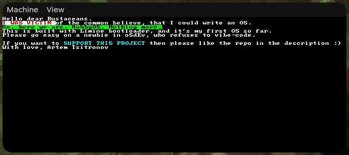

# Hobby-OS (Artem Tsitronov)

An attempt to create a working OS in Rust.
Also a challenge to not use AI.

## Goals
- *NO AI CODE!!!* Absolutely not, unacceptable! What's the point of developing, if it's not you to do so, but AI!
- *Learn rust better* I have a few serious projects, and I have experience in Rust, but feel insecure about it, wanting to improve
- *"I use Hobby-Os btw"* Yes. I want to say that I created an OS to my friends. Don't judge me.

## What have I done!?

- *I morally prepared myself to use Limine* Of course. Of course, no, no, I couldn't use the normal bootloader crate and do it the easy way! I WANT TO USE LIMINE, OF COURSE. ...why am I doing this, I'll regret this so much later...
- *I used Limine* I was FORCED to implement VGA, because apparently limine doesn't do it. Welp, a good thing in the future? I think?

## Status so far

Don't use it.
Support? Yes. I would appreciate that
Usage? How do you even use it, all it has is a text driver!
